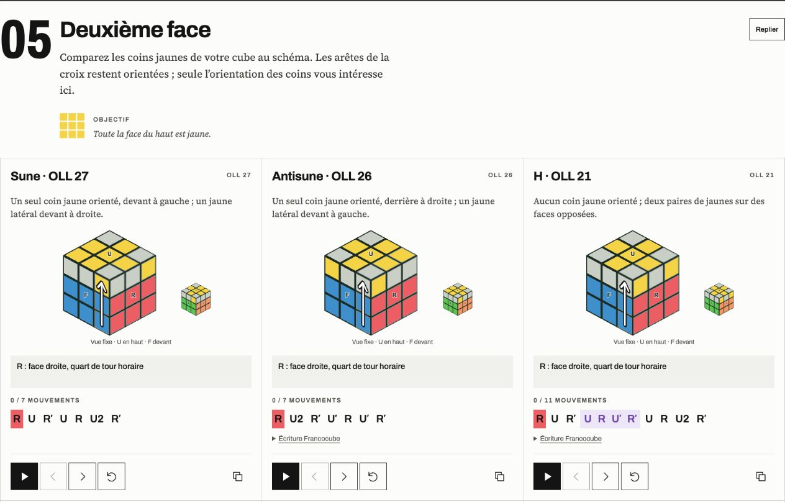
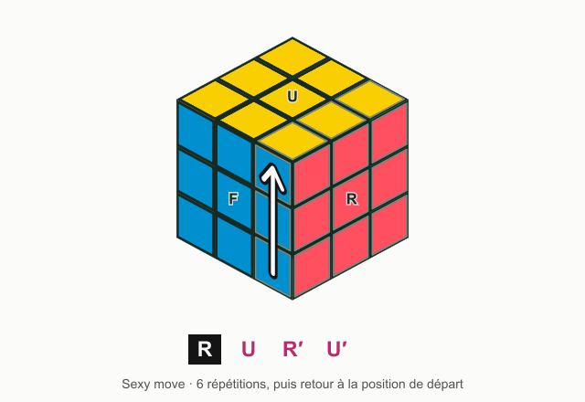
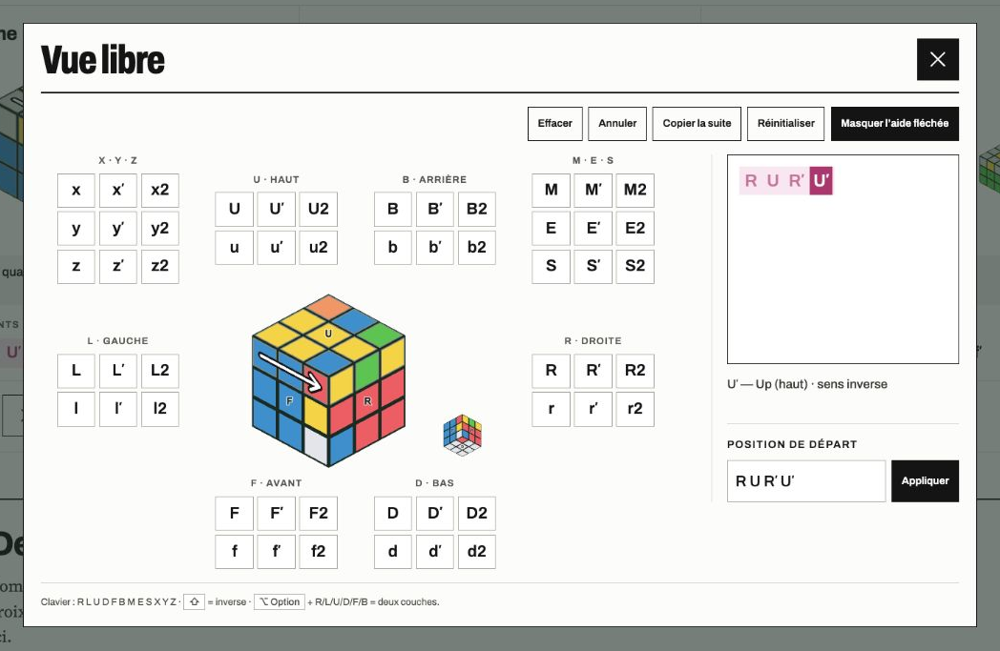
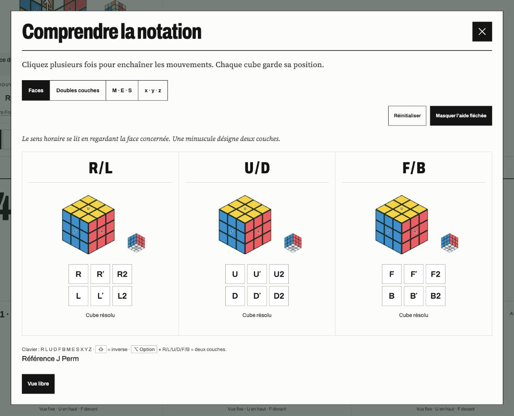

<picture>
  <source media="(prefers-color-scheme: dark)" srcset="docs/assets/logo-dark.svg">
  
</picture>

# Apprendre le Rubik’s Cube, mouvement par mouvement

**sub 40″** est un guide interactif de la méthode intermédiaire du cube 3 × 3. Sept étapes, 26 démonstrations et un cube à manipuler pour comprendre ce que fait chaque mouvement.

[Essayer l’application](https://cube-methode-claire-hp.calmmyna5.chatgpt.site/) · [Démarrer en local](#démarrer-en-local) · [Contribuer](#contribuer) · [Signaler un problème](https://github.com/lets-cube/sub-40/issues)



## Ce qu’on peut faire

- **Apprendre la méthode** : avancer de la première face jusqu’au placement des dernières arêtes, avec les cas à reconnaître et les objectifs de chaque étape.
- **Décomposer un algorithme** : lancer la lecture, avancer ou reculer d’un coup, ou cliquer sur une lettre pour retrouver la position juste avant ce mouvement.
- **Voir les couches qui tournent** : activer les flèches et les contours des pièces concernées, y compris pour les mouvements de deux couches.
- **Comprendre la notation** : essayer les faces R/L, U/D et F/B, les tranches M/E/S et les rotations x/y/z sur des cubes qui conservent leur position.
- **Repérer les motifs** : retrouver le sexy move, son inverse et le sledgehammer grâce à leurs couleurs dans les formules.
- **Tester une combinaison** : jouer au clavier ou avec les boutons de la vue libre, saisir une position de départ, puis revenir à un coup de l’historique pour essayer une autre suite.

### Du mouvement à la formule

Le sexy move : **R U R′ U′**. Les quatre gestes sont animés ci-dessous, avec le même moteur que dans l’application. Six répétitions ramènent le cube à sa position de départ.

<picture>
  <source media="(prefers-reduced-motion: reduce)" srcset="docs/assets/cube-still.png">
  
</picture>

### Un cube pour expérimenter

La vue libre garde tous les mouvements saisis, même quand on enchaîne rapidement. Cliquer dans l’historique retrouve la position après ce coup ; le mouvement suivant démarre une nouvelle suite depuis cette position.



<details>
<summary>Voir aussi le tutoriel de notation</summary>

Chaque paire de faces partage un cube. Les boutons donnent directement accès au quart de tour, à l’inverse et au demi-tour.



</details>

## Prendre le cube en main

Les exemples commencent par le blanc, avec **le jaune en haut et le bleu devant**. Sur le dessin, F (_Front_) est la face visible à gauche : c’est celle à tenir devant soi. La petite vue complète les faces visibles ; à partir de l’étape 04, elle montre U–B–L.

L’aide fléchée s’active depuis le menu. Dans la notation et la vue libre, les raccourcis sont :

| Touches                                                   | Action                       |
| --------------------------------------------------------- | ---------------------------- |
| R, L, U, D, F, B                                          | Tourner une face             |
| M, E, S                                                   | Tourner une tranche centrale |
| X, Y, Z                                                   | Tourner le cube entier       |
| Maj + lettre                                              | Faire le mouvement inverse   |
| Option sur Mac, ou Alt sur Windows/Linux + lettre de face | Tourner deux couches         |

« Position de départ » accepte les formules et les répétitions, par exemple `(R U R′ U′)2`, et les applique depuis un cube résolu.

## Démarrer en local

Prérequis : **Bun ≥ 1.3** et **Node.js ≥ 22.12**. Le fichier `bun.lock` fixe les versions des dépendances.

```sh
git clone https://github.com/lets-cube/sub-40.git
cd sub-40
bun install --frozen-lockfile
bun run dev
```

Ouvrir l’adresse affichée par Vite, habituellement [localhost:5173](http://localhost:5173).

### Commandes utiles

| Commande           | Usage                                                |
| ------------------ | ---------------------------------------------------- |
| `bun run dev`      | Développer avec rechargement automatique             |
| `bun run check`    | Vérifier lint, format, types et tests                |
| `bun run lint:fix` | Appliquer les corrections de lint automatiques sûres |
| `bun run fmt`      | Formater le dépôt avec Oxfmt                         |
| `bun run build`    | Construire le site dans `dist/`                      |
| `bun run preview`  | Essayer le site compilé en local                     |

React et TypeScript gèrent l’interface ; le moteur du cube et son rendu SVG sont séparés des composants. Le projet utilise Vite, Vitest, Oxlint et Oxfmt. Les polices sont incluses dans le dépôt.

Le résultat est un **site statique**, à héberger en publiant `dist/`. Il ne demande ni compte, ni base de données, ni serveur applicatif.

## Contribuer

Les corrections de textes, les retours d’apprentissage, les améliorations d’accessibilité et les corrections du simulateur sont les bienvenus.

- **Un bug ?** [Ouvrir une issue](https://github.com/lets-cube/sub-40/issues) avec la formule jouée, le résultat attendu et, si possible, une capture.
- **Une amélioration ?** Proposer une pull request avec une explication du changement et ses vérifications.
- **Une première contribution ?** Les textes sont dans `src/data/`, l’interface dans `src/components/`, le moteur dans `src/cube/` et le style dans `src/styles/`.

Avant de proposer une modification :

```sh
bun run check
bun run build
```

Les tests vérifient notamment 310 positions de référence Francocube, les directions des flèches, les mouvements en file et la reprise de l’historique.

Le [guide de contribution](CONTRIBUTING.md) précise comment démarrer, décrire un problème et vérifier les changements.

## Crédits et licences

- **Code original de sub 40″** : [licence MIT](LICENSE).
- **Démonstrations et masques pédagogiques** : adaptés de la [méthode intermédiaire de Deadalnix / Francocube](https://www.francocube.com/deadalnix/moyen), sous [CC BY-SA 2.0 FR](https://creativecommons.org/licenses/by-sa/2.0/fr/). Cette licence reste applicable à ces contenus.
- **Référence de notation** : [J Perm](https://jperm.net/3x3/moves).
- **Motifs** : [SpeedCubeReview](https://www.speedcubereview.com/oll-groups.html) et [melody.games](https://cube.melody.games/).
- **Typographies** : Archivo et Source Serif 4, sous SIL Open Font License. Les notices sont dans [`public/fonts/`](public/fonts/).

Le logo utilise Archivo 800, largeur 75 %, convertie en tracés SVG pour s’afficher avec la même typographie sur tous les supports.
