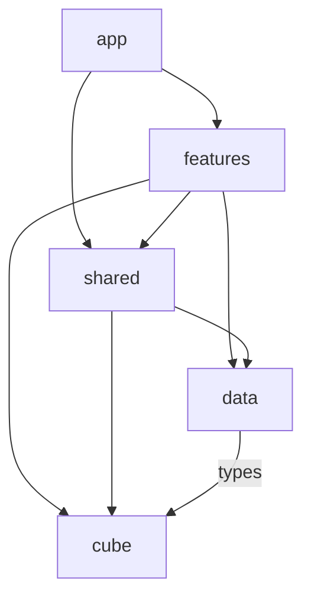

# Architecture du client web

sub 40″ est une application statique avec une page de méthode et trois outils en fenêtres. Son découpage suit les fonctionnalités, avec un moteur du cube indépendant de React.

## Structure

```text
src/
  App.tsx                   Point de composition
  app/
    AppProvider.tsx         État global de l’interface et coordination des lecteurs
    AppShell.tsx            En-tête, page de méthode, pied de page et fenêtres
    AppDialogs.tsx          Assemblage des trois outils
    layout/                 Navigation et pied de page du site
    navigation.constants.ts Outils de navigation et titres des fenêtres
    app.constants.ts        Nom du site et durée des notifications
  features/
    method/                 Introduction, sommaire, étapes, cas et navigation par ancre
    notation/               Familles de mouvements et cubes de démonstration
    free-view/              Commandes, historique et position de départ
    patterns/               Cartes des motifs
  shared/
    components/             Dialogue, cube SVG, formule et contrôles réutilisés
    hooks/                  Adaptation des lecteurs et raccourcis clavier à React
    state/                  Contrat du contexte d’interface et hook d’accès
    constants/              Paramètres d’interface, touches et liens de référence
    utils/                  Style des mouvements
  cube/
    types.ts                Types du domaine
    constants.ts            Faces, axes, directions et couleurs
    engine.ts               États, rotations et opérations sur les formules
    notation.ts             Validation des positions de départ et lecture du clavier
    notation.constants.ts   Noms des mouvements et limites de saisie
    playback.ts             Lecture, animations, file de mouvements et historique
    playback.constants.ts   Durées des rotations et des pauses
    render.ts               Projection SVG et flèches
    patterns.ts             Recherche de motifs, fournis par l’appelant
  data/                     Contenus JSON, types et exports des données pédagogiques
  styles/                   Styles communs et variables du design
```

`App.tsx` assemble le fournisseur de contexte et l’application. Le contenu d’une étape appartient à `features/method/`, la position de départ à `features/free-view/`, et le calcul d’un quart de tour à `cube/`.

## Dépendances



- `app/` assemble les fonctionnalités et le cadre du site.
- Une fonctionnalité utilise ses propres composants, puis le socle partagé, les données et le moteur. Elle ne dépend pas de `app/`.
- `shared/` contient ce qui est réellement utilisé par plusieurs fonctionnalités. Il ne dépend ni de `app/`, ni de `features/`.
- `cube/` ne dépend ni de React, ni des composants, ni du contenu pédagogique. Par exemple, les motifs à rechercher sont passés en argument au moteur.

Ces limites sont vérifiées par Oxlint : un import de React depuis `cube/`, ou d’un écran depuis `shared/`, fait échouer `bun run lint`. Les fonctionnalités sont assemblées par `app/` ; un besoin commun entre deux fonctionnalités se place dans `shared/`.

## État et cycle de vie

L’état reste au plus près de ce qui l’utilise :

- Le dépliage des étapes appartient à `useLessonNavigation`, appelé par `AppShell` pour coordonner la page et les liens de l’en-tête.
- La famille de notation sélectionnée reste dans `NotationExplorer`.
- Chaque cube possède son lecteur. Le lecteur gère les stickers, l’animation et la file de mouvements ; les hooks React s’y abonnent avec `useSyncExternalStore`.
- Le contexte global partage uniquement les outils transversaux : fenêtre ouverte, aide fléchée, copie et coordination des lecteurs.

Les contenus des fenêtres restent montés à leur fermeture. Leur état est donc conservé : fermer puis rouvrir la vue libre ne remet pas le cube à zéro. Les effets nettoient leurs abonnements au démontage.

Ce projet n’a actuellement besoin ni d’un routeur complet, ni d’une bibliothèque de requêtes réseau, ni d’un store global supplémentaire. Les ancres, les props, les hooks et le contexte répondent aux usages présents.

## Constantes et contenu

Les constantes sont placées avec leur propriétaire : familles dans `notation.constants.ts`, disposition des touches dans `free-view.constants.ts`, durées dans `playback.constants.ts`. Les constantes partagées sont limitées à leur domaine ; il n’y a pas de fichier global regroupant tous les paramètres.

Les valeurs calculées pendant un rendu restent locales. Les textes pédagogiques et les algorithmes restent dans les fichiers JSON de `data/`. Les couleurs du design restent dans les variables CSS de `styles/`.

## Vérifications

```sh
bun run check
bun run build
```

Les tests couvrent les 310 états de référence Francocube, les projections des flèches, les commandes et l’historique. Les tests de configuration vérifient aussi que les 54 commandes de la vue libre restent uniques, que les faces opposées restent regroupées et que les ancres correspondent aux étapes connues.

Ce découpage applique les principes React de [décomposition des composants](https://react.dev/learn/thinking-in-react) et de [partage de l’état au parent commun](https://react.dev/learn/sharing-state-between-components). Les noms de dossiers et les limites de dépendances sont des choix propres à ce projet.
