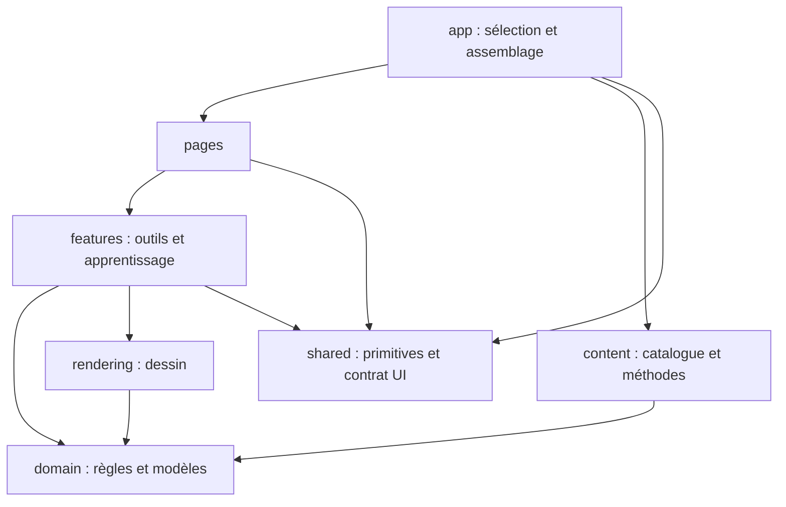

# Architecture du client web

sub 40″ reste un seul projet React, TypeScript et Vite, livré comme site statique. Son organisation sépare les règles du puzzle, les méthodes pédagogiques et les outils interactifs. Elle s’inspire du découpage par fonctionnalités et de l’indépendance du domaine des architectures hexagonales ; elle ne prétend pas suivre toutes les couches de Feature-Sliced Design.

## Structure

```text
src/
  App.tsx                     Fournisseur d’interface et assemblage
  app/                        En-tête, fenêtres, navigation et préférences communes
    active-method.ts          Choix de la méthode affichée
  pages/
    method/                   Composition de la page à partir d’une méthode fournie
  features/
    learn-method/             Introduction, sommaire, étapes, cas et ancres
    play-algorithm/
      model/                  Lecture, animations, file et historique, sans navigateur
      browser/                Horloge réelle et interprétation des touches
      hooks/                  Abonnements React et création des lecteurs
      ui/                     Formules, commandes et contrôles de lecture
    explore-puzzle/           Vue libre, position de départ et historique cliquable
    understand-notation/      Familles de notation et cubes de démonstration
    learn-patterns/           Cartes des motifs
  domain/
    puzzles/cube-3x3/          États, rotations, formules et notation du 3×3
    learning/                 Modèles pédagogiques, références de cas et motifs
  content/
    catalog.ts                Méthodes disponibles, identifiées par puzzle + méthode
    types.ts                  Contenus 3×3 illustrés et métadonnées d’affichage
    validate.ts               Vérifications spécifiques aux contenus 3×3
    methods/3x3/intermediate/  JSON et définition de la méthode intermédiaire
  rendering/
    svg/cube-3x3/             Projection SVG, caméras et flèches du 3×3
    react/                    Adaptateur React du dessin SVG
  shared/
    components/               Dialogue et icônes sans logique de puzzle
    constants/                Identifiants d’interface et liens communs
    state/                    Contrat du contexte d’interface
  styles/                     Polices, couleurs et mise en page
scripts/
  validate-content.ts         Validation de tout le catalogue au build
```

Les dossiers décrivent les besoins présents. Il n’existe aucun moteur 2×2, catalogue de méthodes fictives, registre de plugins, serveur ou couche de persistance anticipée.

## Dépendances



Les pages et les fonctionnalités utilisent les **types** de contenu, mais n’importent aucune méthode du catalogue. `AppShell` leur fournit la méthode active, ses étapes et ses motifs. Modifier le contenu sélectionné ne nécessite donc pas de réécrire les composants de la méthode.

`play-algorithm` est un module fonctionnel réutilisé par les autres fonctionnalités. Celles-ci peuvent importer ses contrats, ses hooks et ses contrôles ; le lecteur ne connaît pas ses consommateurs. Les fonctionnalités consommatrices ne s’importent pas entre elles. Ce choix assume une architecture modulaire adaptée au projet, plutôt qu’une application stricte des règles FSD.

Oxlint interdit les imports qui inversent ces dépendances :

- Le domaine n’importe ni React, ni données JSON, ni interface, ni rendu.
- Le contenu dépend des modèles du domaine, pas des outils ou du rendu.
- Le rendu reçoit un état et des options ; il ne connaît aucune méthode pédagogique.
- `shared/` ne dépend d’aucun module métier.
- Les pages et fonctionnalités ne choisissent pas leur méthode depuis le catalogue.
- Le modèle de lecture ne dépend pas de React ni de son adaptateur navigateur.

`tsconfig.domain.json` compile séparément le domaine, le lecteur et le rendu SVG **sans la bibliothèque DOM ni les types Node**. Un accès à `window`, `KeyboardEvent` ou `requestAnimationFrame` dans ces modules échoue à la vérification des types.

## Puzzle, méthode et session

Ces trois concepts ont des responsabilités distinctes :

- Le **puzzle** définit son état et ses mouvements. Le 3×3 reste une implémentation concrète, avec ses 54 stickers et sa notation.
- La **méthode** décrit des étapes et des cas associés à un `puzzleId`. Les modèles pédagogiques génériques ne supposent ni faces, ni centres, ni taille de cube.
- La **session** possède la position courante, les animations, la file et l’historique. Les contrôles React s’y abonnent avec `useSyncExternalStore`.

`LearningMethod` décrit la structure pédagogique. `Cube3x3Method` y ajoute les masques 3×3, les diagrammes d’objectifs et les métadonnées des vues. Les cas sont résolus par leur identifiant, jamais par `cases[id - 1]`. Les numéros d’étapes n’ont pas à être contigus.

Les motifs sont fournis aux formules par le contenu actif. Leur recherche porte sur des séquences de tokens : le domaine pédagogique ne doit pas connaître le parseur du 3×3. Les couleurs des motifs restent des métadonnées d’affichage.

Le lecteur reçoit une `Clock` au constructeur. Les hooks lui donnent `browserClock`, qui encapsule `requestAnimationFrame`, les pauses et la préférence de réduction des mouvements. Les tests lui donnent une horloge déterministe. Aucune injection de dépendances supplémentaire n’est nécessaire.

## État React

Le contexte conserve uniquement la fenêtre ouverte, l’aide fléchée, la copie et la coordination des lecteurs. Il connaît un contrat `Pausable`, pas la classe concrète du lecteur.

Le dépliage des étapes appartient à la navigation de la méthode ; la famille sélectionnée appartient à l’outil de notation. Chaque cube possède son lecteur. Les contenus des fenêtres restent montés à leur fermeture : l’état des cubes, des formules et de l’historique est conservé.

Les constantes restent dans leur module propriétaire. Les durées sont dans `playback.constants.ts`, les familles dans `notation.constants.ts`, la disposition des commandes dans `free-view.constants.ts`. Les couleurs CSS et les caméras appartiennent au rendu ou au style, pas au moteur.

## Ajouter une méthode 3×3

1. Créer un dossier dans `content/methods/3x3/` avec ses propres textes, étapes, cas, objectifs et sources. Chaque cas contient sa position cible et sa formule ; les vues et diagrammes sont explicites.
2. Exporter une définition compatible avec `Cube3x3Method`, puis l’enregistrer dans `content/catalog.ts`. La clé est le couple `puzzleId` / `id`.
3. Lancer `bun run validate:content`, puis les tests. La validation refuse les IDs dupliqués, les références manquantes, les formules invalides, les masques incorrects et les diagrammes incohérents.
4. Pour afficher cette méthode à la place de l’actuelle, modifier `app/active-method.ts`. Un futur sélecteur ou route pourra utiliser `findMethod` ; aucune interface de sélection n’est ajoutée aujourd’hui. À ce moment-là, remonter une nouvelle session/navigation avec une clé propre à la méthode sélectionnée.

L’en-tête de méthode, les cas et les motifs n’importent pas le contenu intermédiaire. Les crédits généraux du pied de page décrivent encore le contenu actuellement publié ; ils devront suivre le catalogue si plusieurs méthodes sont exposées au public.

## Ajouter le 2×2

Ajouter d’abord une implémentation concrète sous `domain/puzzles/cube-2x2/`, puis son rendu et ses contenus. Vérifier ses rotations avec des références indépendantes. Les contrôles de notation, les diagrammes et les repères devront tenir compte de l’absence de centres et de tranches centrales.

Le lecteur et le rendu actuels sont encore typés pour le 3×3. Lorsque le second moteur existe, extraire le petit contrat commun réellement nécessaire aux sessions et au rendu. Ne pas simuler la prise en charge du 2×2 en ajoutant simplement un paramètre `size` au moteur actuel. La compilation et la validation de contenu restent le point de passage pour chaque nouveau puzzle.

## Vérifications

```sh
bun run check
bun run build
```

`check` lance Oxlint, Oxfmt, la validation des contenus, les deux vérifications TypeScript et Vitest. `build` valide également les contenus avant de produire `dist/`.

Les tests conservent les 26 formules et masques et les 310 positions de référence Francocube, les 216 projections des flèches et les comportements de lecture. Ils couvrent aussi les contenus invalides, les IDs non contigus, la sélection du contenu par les composants et la coloration des seuls motifs fournis.

Références : [Feature-Sliced Design](https://feature-sliced.design/docs/get-started/overview), [Bulletproof React](https://github.com/alan2207/bulletproof-react/blob/master/docs/project-structure.md), [architecture hexagonale](https://alistair.cockburn.us/hexagonal-architecture), [partage de l’état React](https://react.dev/learn/sharing-state-between-components). Les conventions et limites ci-dessus restent des choix propres à sub 40″.
